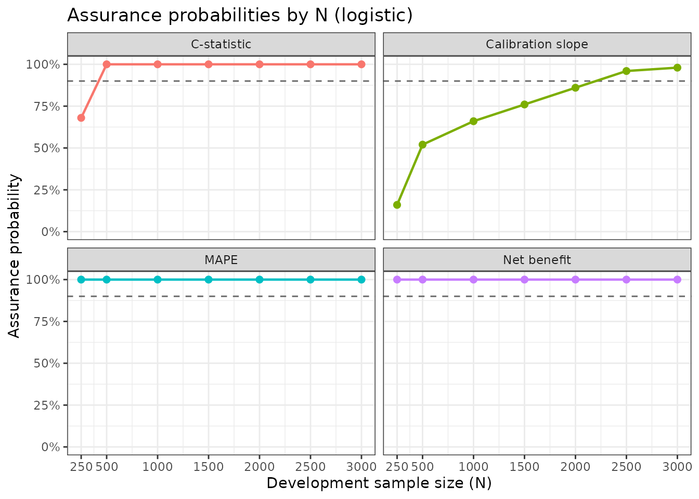
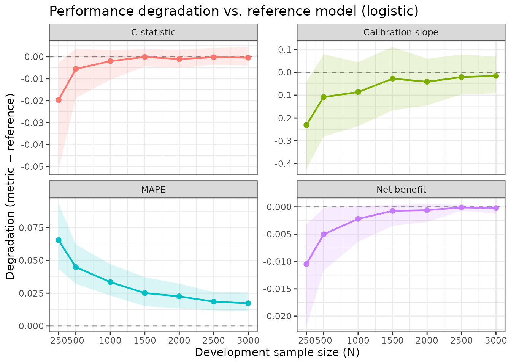
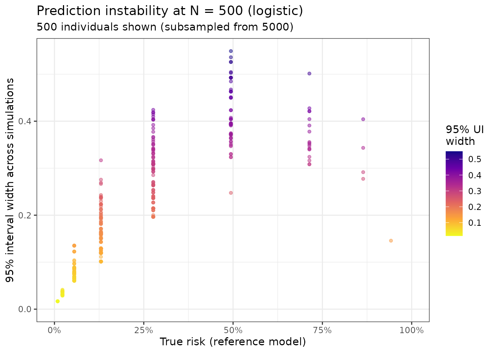
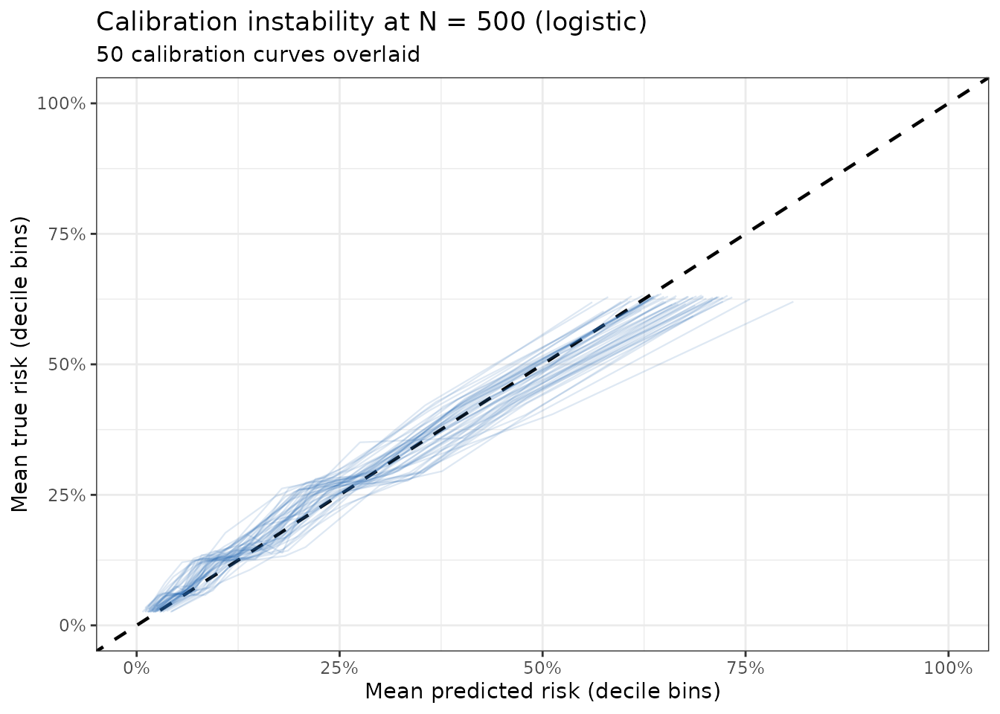

# Getting Started with pmgen: DVT Prediction Model Example

## Overview

The `pmgen_*()` functions implement the general simulation-based
framework for determining sample sizes when developing clinical
prediction models (CPMs) described by Riley et al. (2026). Unlike the
closed-form criteria in
[`pmsampsize()`](https://joieensor.github.io/pmsampsize/reference/pmsampsize.md),
the generalised approach works for any supervised learning method and
provides rich summaries of how model performance degrades at different
sample sizes.

This vignette walks through a complete sample size calculation for a
binary outcome CPM using the DVT (deep vein thrombosis) dataset. The
workflow has four steps:

1.  **Specify a reference model**: calibrate a logistic model to your
    target prevalence and c-statistic using the joint predictor
    distribution from your data.
2.  **Generate a target population**: create a large evaluation dataset
    from the reference model.
3.  **Run the simulation**: repeatedly sample development datasets of
    varying sizes, fit a model, and evaluate performance against the
    target population.
4.  **Summarise and plot**: identify the minimum sample size meeting
    your criteria and visualise how performance changes with N.

## The DVT Example

We want to develop a logistic regression model to predict DVT diagnosis
from 11 binary clinical predictors. The dataset (`dvt_data`) contains
9,805 patients from seven studies and has a DVT prevalence of
approximately 21%. A logistic regression model on this data achieves an
AUC (c-statistic) of about 0.79.

We will use these observed values to specify a **reference model**, a
hypothetical “true” model representing the best achievable performance
given the predictor set, and then ask: at what sample size does a newly
developed model closely approximate this reference?

``` r

library(pmsampsize)

data(dvt_data)

predictors <- c("male", "OCuse", "malignancy", "surgery", "ab_leg_trauma",
                 "vein_distension", "calf_diff", "ab_ddimer",
                 "pregnancy", "immobile", "clotting")

cat("Rows:", nrow(dvt_data), "\n")
#> Rows: 9805
cat("DVT prevalence:", round(mean(dvt_data$dvt), 3), "\n")
#> DVT prevalence: 0.209
```

## Step 1: Specify the Reference Model

[`pmgen_reference()`](https://joieensor.github.io/pmsampsize/reference/pmgen_reference.md)
calibrates a logistic model to a target prevalence and c-statistic. We
supply `dvt_data` as `joint_data`; this represents the joint
distribution of predictors in the target population, and is used for the
bisection calibration.

We assume equal relative log-odds weights for all 11 predictors
(`coef = NULL`), a simple default when we do not have prior knowledge of
individual predictor effects. Where the relative sizes of the effects
are known, supply them as `coef`: the equal-weights model can give
somewhat different results.

``` r

ref <- pmgen_reference(
  joint_data  = dvt_data,
  predictors  = predictors,
  prevalence  = 0.21,
  cstatistic  = 0.78,
  tolerance   = 0.005,
  seed        = 42
)
#> Running bisection to calibrate reference model...
#> Bisection converged: prevalence=0.2097 (target=0.2100), c-stat=0.7808 (target=0.7800)
#> Unit information matrix computed and cached.

ref
#> pmgen reference model
#> ---------------------
#>   Predictors        : male, OCuse, malignancy, surgery, ab_leg_trauma, vein_distension, calf_diff, ab_ddimer, pregnancy, immobile, clotting
#>   Intercept         : -4.7119
#>   Prevalence (achieved): 0.2097
#>   C-statistic (achieved): 0.7808
#>   Coefficients      :
#>            male           OCuse      malignancy         surgery   ab_leg_trauma 
#>          0.9375          0.9375          0.9375          0.9375          0.9375 
#> vein_distension       calf_diff       ab_ddimer       pregnancy        immobile 
#>          0.9375          0.9375          0.9375          0.9375          0.9375 
#>        clotting 
#>          0.9375 
#>   Unit info matrix  : cached (12x12)
```

The `ref` object contains the calibrated intercept and scaled
coefficients and the achieved prevalence and c-statistic.

## Step 2: Generate the Target Population

The target population is a large dataset sampled from the joint
predictor distribution and assigned true risks using the reference
model. All simulated development models are evaluated against this fixed
population, so performance estimates are comparable across simulation
iterations. The rows of `joint_data` not used for the target population
form the development pool from which development datasets are drawn, so
`n` must be smaller than `nrow(joint_data)`. In practice use as large a
target population as the data allow (e.g. 100,000 when `joint_data` is
large or synthetic).

``` r

target_pop <- pmgen_target_population(
  ref_model = ref,
  n         = 5000,
  seed      = 42
)

cat("Target population: n =", nrow(target_pop$data), "\n")
#> Target population: n = 5000
cat("Development pool:  n =", nrow(target_pop$dev_pool), "\n")
#> Development pool:  n = 4805
cat("True risk range:", round(range(target_pop$data$p_true), 3), "\n")
#> True risk range: 0.009 0.976
cat("Simulated prevalence:", round(mean(target_pop$data$outcome), 3), "\n")
#> Simulated prevalence: 0.208
```

## Step 3: Run the Simulation

[`pmgen_simulate()`](https://joieensor.github.io/pmsampsize/reference/pmgen_simulate.md)
is the core function. For each value of N in the `N` vector, it:

1.  Samples a development dataset of size N (with replacement from the
    development pool).
2.  Simulates binary outcomes using the reference model’s true risks.
3.  Fits the chosen model on the development data.
4.  Predicts on the target population.
5.  Computes all requested performance metrics.

This repeats `n_sims` times (default 1,000). Here we use `n_sims = 50`
so the vignette builds quickly; use at least 500 to 1,000 in practice.

We evaluate logistic regression across a range of sample sizes.

``` r

result <- pmgen_simulate(
  ref_model   = ref,
  target_pop  = target_pop,
  N           = c(250, 500, 1000, 1500, 2000, 2500, 3000),
  n_sims             = n_sims_vignette,
  method             = "logistic",
  metrics            = c("cstat", "cal_slope", "mape", "net_benefit"),
  threshold          = 0.2,    # clinical decision threshold for net benefit
  store_predictions  = TRUE,
  seed               = 42,
  verbose            = FALSE
)

result
#> pmgen result
#> ------------
#>   Method              : logistic
#>   N values            : 250, 500, 1000, 1500, 2000, 2500, 3000
#>   Metrics             : cstat, cal_slope, mape, net_benefit
#>   Draws/N             : 50
#>   Predictions stored  : yes
#>   Perfect prediction  : fits with predictors dropped
#>     N = 250: 3/50 (OCuse 1, ab_leg_trauma 2)
#> 
#> Summary (means across simulations):
#>     N      metric       mean           sd       q025       q975
#>   250       cstat 0.77152667 0.0135627685 0.74012928 0.78853659
#>   250   cal_slope 0.78078664 0.1078134490 0.58848037 0.96992815
#>   250        mape 0.06542969 0.0135435345 0.04356957 0.09300101
#>   250 net_benefit 0.08519100 0.0051986820 0.07384250 0.09238875
#>   500       cstat 0.78563988 0.0058709288 0.77248272 0.79478783
#>   500   cal_slope 0.90376577 0.1029239820 0.73080343 1.09160101
#>   500        mape 0.04484582 0.0084909867 0.03205256 0.06211988
#>   500 net_benefit 0.09063000 0.0032011159 0.08399125 0.09548750
#>  1000       cstat 0.78918144 0.0034978413 0.78073911 0.79429331
#>  1000   cal_slope 0.92589984 0.0807129822 0.77602050 1.05667303
#>  1000        mape 0.03346984 0.0071702731 0.02322919 0.04715885
#>  1000 net_benefit 0.09345200 0.0017484676 0.08925625 0.09585375
#>  1500       cstat 0.79107965 0.0022409175 0.78683923 0.79465708
#>  1500   cal_slope 0.98477179 0.0762874526 0.84566338 1.12382643
#>  1500        mape 0.02511734 0.0058529178 0.01516533 0.03717574
#>  1500 net_benefit 0.09491700 0.0010782455 0.09217250 0.09603875
#>  2000       cstat 0.79014095 0.0024544764 0.78615345 0.79447192
#>  2000   cal_slope 0.97112516 0.0553089194 0.86740134 1.07163210
#>  2000        mape 0.02258441 0.0050311409 0.01344742 0.03225466
#>  2000 net_benefit 0.09505300 0.0008705739 0.09287875 0.09618750
#>  2500       cstat 0.79095921 0.0021452362 0.78754241 0.79521947
#>  2500   cal_slope 0.99120338 0.0484123681 0.91577962 1.09053785
#>  2500        mape 0.01858891 0.0038321705 0.01193149 0.02587938
#>  2500 net_benefit 0.09554800 0.0002948469 0.09495000 0.09602750
#>  3000       cstat 0.79076518 0.0022581377 0.78717040 0.79566550
#>  3000   cal_slope 0.99706630 0.0470520484 0.92046170 1.08134394
#>  3000        mape 0.01733641 0.0039533199 0.01137116 0.02548496
#>  3000 net_benefit 0.09543500 0.0003801517 0.09439500 0.09573875
#>  degradation_mean
#>     -0.0196552269
#>     -0.2314341509
#>      0.0654296900
#>     -0.0104590000
#>     -0.0055420219
#>     -0.1084550260
#>      0.0448458228
#>     -0.0050200000
#>     -0.0020004615
#>     -0.0863209472
#>      0.0334698370
#>     -0.0021980000
#>     -0.0001022537
#>     -0.0274489986
#>      0.0251173437
#>     -0.0007330000
#>     -0.0010409483
#>     -0.0410956265
#>      0.0225844144
#>     -0.0005970000
#>     -0.0002226908
#>     -0.0210174111
#>      0.0185889098
#>     -0.0001020000
#>     -0.0004167161
#>     -0.0151544951
#>      0.0173364054
#>     -0.0002150000
```

Penalised methods are also built in: `method = "ridge"`, `"lasso"` or
`"elasticnet"` (these need the glmnet package) and `"firth"` (needs
logistf). You can also supply your own fitting function; see
[`?pmgen_simulate`](https://joieensor.github.io/pmsampsize/reference/pmgen_simulate.md).

## Parallelisation

If the furrr package is installed,
[`pmgen_simulate()`](https://joieensor.github.io/pmsampsize/reference/pmgen_simulate.md)
runs its simulations with
[`furrr::future_map()`](https://furrr.futureverse.org/reference/future_map.html),
so it respects whatever `future` plan is active. On a multicore machine
you can cut runtime roughly in proportion to the number of cores by
setting a parallel plan before the call. Without furrr, or without a
parallel plan, the simulations run sequentially.

### Shared-memory parallelism (single machine)

``` r

library(future)

# Use all available cores (or set workers = N for a specific number)
plan(multisession)

result_par <- pmgen_simulate(
  ref_model   = ref,
  target_pop  = target_pop,
  N           = c(250, 500, 1000, 1500, 2000, 2500, 3000),
  n_sims      = 1000,
  method      = "logistic",
  metrics     = c("cstat", "cal_slope", "mape", "net_benefit"),
  threshold   = 0.2,
  seed        = 42,
  verbose     = FALSE
)

# Always restore sequential execution when done
plan(sequential)
```

Parallelism is across simulation draws within each N value. With
`n_sims = 1000` and 4 cores, wall time is approximately 4 times faster
than sequential.

### Limiting the number of workers

``` r

plan(multisession, workers = 4)  # cap at 4 cores regardless of machine size

result_par <- pmgen_simulate(
  ref_model  = ref,
  target_pop = target_pop,
  N           = c(250, 500, 1000, 1500, 2000, 2500, 3000),
  n_sims     = 1000,
  method     = "logistic",
  seed       = 42,
  verbose    = FALSE
)

plan(sequential)
```

### Reproducibility under parallelism

Each simulation sets its own seed, computed before the parallel loop
from `seed`, the value of N and `n_sims`. The same `seed` therefore
gives identical results whether you run sequentially or in parallel,
with any number of workers:

``` r

plan(sequential)
result_seq <- pmgen_simulate(ref, target_pop, N = c(200, 500), n_sims = 50,
                             method = "logistic", seed = 1)

plan(multisession, workers = 2)
result_par <- pmgen_simulate(ref, target_pop, N = c(200, 500), n_sims = 50,
                             method = "logistic", seed = 1)
plan(sequential)

# Summaries are identical
all.equal(summary(result_seq), summary(result_par))
```

Because an N value’s seeds do not depend on the other values in `N`, a
grid can be extended later: `N = c(500, 800)` with `seed = 1` gives the
same results for N = 500 as above. Likewise, increasing `n_sims` keeps
the earlier simulations and adds new ones.

### Choosing the right number of workers

| Scenario | Recommendation |
|----|----|
| Interactive session, quick exploration | `plan(sequential)`: no overhead |
| Final analysis, `n_sims` of 500 or more, single machine | `plan(multisession)` (all cores) |
| Large grid of N values, HPC cluster | `plan(cluster)`: see [`?future::cluster`](https://future.futureverse.org/reference/cluster.html) |
| Memory-constrained machine | `plan(multisession, workers = 2)` |

Each worker loads a copy of `target_pop` and `ref_model` into memory.
For a `target_pop` of 50,000 rows and 11 predictors this is modest (~10
MB per worker); for 500,000 rows consider capping workers to avoid
memory pressure.

## Step 4: Summarise Results

[`summary()`](https://rdrr.io/r/base/summary.html) produces a table of
performance summaries for each N, matching the structure reported in
Riley et al. (2026). For each metric it shows the mean, standard
deviation, 2.5th and 97.5th percentiles, and the mean degradation versus
the reference model.

``` r

summary(result)
#>       N      metric       mean           sd       q025       q975
#> 1   250       cstat 0.77152667 0.0135627685 0.74012928 0.78853659
#> 2   250   cal_slope 0.78078664 0.1078134490 0.58848037 0.96992815
#> 3   250        mape 0.06542969 0.0135435345 0.04356957 0.09300101
#> 4   250 net_benefit 0.08519100 0.0051986820 0.07384250 0.09238875
#> 5   500       cstat 0.78563988 0.0058709288 0.77248272 0.79478783
#> 6   500   cal_slope 0.90376577 0.1029239820 0.73080343 1.09160101
#> 7   500        mape 0.04484582 0.0084909867 0.03205256 0.06211988
#> 8   500 net_benefit 0.09063000 0.0032011159 0.08399125 0.09548750
#> 9  1000       cstat 0.78918144 0.0034978413 0.78073911 0.79429331
#> 10 1000   cal_slope 0.92589984 0.0807129822 0.77602050 1.05667303
#> 11 1000        mape 0.03346984 0.0071702731 0.02322919 0.04715885
#> 12 1000 net_benefit 0.09345200 0.0017484676 0.08925625 0.09585375
#> 13 1500       cstat 0.79107965 0.0022409175 0.78683923 0.79465708
#> 14 1500   cal_slope 0.98477179 0.0762874526 0.84566338 1.12382643
#> 15 1500        mape 0.02511734 0.0058529178 0.01516533 0.03717574
#> 16 1500 net_benefit 0.09491700 0.0010782455 0.09217250 0.09603875
#> 17 2000       cstat 0.79014095 0.0024544764 0.78615345 0.79447192
#> 18 2000   cal_slope 0.97112516 0.0553089194 0.86740134 1.07163210
#> 19 2000        mape 0.02258441 0.0050311409 0.01344742 0.03225466
#> 20 2000 net_benefit 0.09505300 0.0008705739 0.09287875 0.09618750
#> 21 2500       cstat 0.79095921 0.0021452362 0.78754241 0.79521947
#> 22 2500   cal_slope 0.99120338 0.0484123681 0.91577962 1.09053785
#> 23 2500        mape 0.01858891 0.0038321705 0.01193149 0.02587938
#> 24 2500 net_benefit 0.09554800 0.0002948469 0.09495000 0.09602750
#> 25 3000       cstat 0.79076518 0.0022581377 0.78717040 0.79566550
#> 26 3000   cal_slope 0.99706630 0.0470520484 0.92046170 1.08134394
#> 27 3000        mape 0.01733641 0.0039533199 0.01137116 0.02548496
#> 28 3000 net_benefit 0.09543500 0.0003801517 0.09439500 0.09573875
#>    degradation_mean
#> 1     -0.0196552269
#> 2     -0.2314341509
#> 3      0.0654296900
#> 4     -0.0104590000
#> 5     -0.0055420219
#> 6     -0.1084550260
#> 7      0.0448458228
#> 8     -0.0050200000
#> 9     -0.0020004615
#> 10    -0.0863209472
#> 11     0.0334698370
#> 12    -0.0021980000
#> 13    -0.0001022537
#> 14    -0.0274489986
#> 15     0.0251173437
#> 16    -0.0007330000
#> 17    -0.0010409483
#> 18    -0.0410956265
#> 19     0.0225844144
#> 20    -0.0005970000
#> 21    -0.0002226908
#> 22    -0.0210174111
#> 23     0.0185889098
#> 24    -0.0001020000
#> 25    -0.0004167161
#> 26    -0.0151544951
#> 27     0.0173364054
#> 28    -0.0002150000
```

## Step 5: Find the Minimum Sample Size

[`pmgen_min_n()`](https://joieensor.github.io/pmsampsize/reference/pmgen_min_n.md)
scans across N values and reports the minimum N at which all specified
criteria are met. The criteria below follow the guidance in Riley et
al. (2026). (With the small `n_sims` used to build this vignette the
result is noisy; use 1000 or more in practice.)

- **Calibration slope**: P(0.9 \<= slope \<= 1.1) \>= 0.90
- **C-statistic degradation**: mean degradation vs. reference \<= 0.025
- **MAPE**: mean absolute prediction error \<= 0.05

``` r

pmgen_min_n(
  result,
  criteria = list(
    cal_slope  = list(range = c(0.9, 1.1), min_prob = 0.90),
    cstat      = list(max_abs_deg_mean = 0.025),
    mape       = list(max_mean = 0.05)
  )
)
#> pmgen minimum sample size
#> -------------------------
#>   Minimum N : 2500
#> 
#> Criterion compliance by N:
#>     N cal_slope cstat mape all_met
#>   250       no    YES  no      no 
#>   500       no    YES  YES     no 
#>  1000       no    YES  YES     no 
#>  1500       no    YES  YES     no 
#>  2000       no    YES  YES     no 
#>  2500       YES   YES  YES     YES
#>  3000       YES   YES  YES     YES
```

## Visualisation

The plots need the ggplot2 and scales packages.

### Assurance curves

The assurance plot shows, for each metric criterion, how the probability
of meeting that criterion changes with N. The recommended minimum N is
where the curve crosses the 0.9 threshold.

``` r

plot(result, type = "assurance")
```



### Degradation curves

The degradation plot shows mean performance (and 95% simulation range)
vs. N for each metric, relative to the reference model.

``` r

plot(result, type = "degradation")
```



### Prediction instability

The instability plot illustrates how individual-level predicted risks
vary across the simulation draws at a given N. Each point is one
target-population individual; the vertical axis shows the width of their
95% interval of predicted risks.

``` r

plot(result, type = "instability", N = 500)
```



### Calibration instability

The calibration instability plot overlays calibration curves from a
sample of the simulation draws, showing the “fan” of uncertainty that
shrinks as N grows.

``` r

plot(result, type = "calibration", N = 500)
```



## No Data? Using Distributional Assumptions

If you do not have pilot data, you can specify marginal predictor
distributions directly:

``` r

ref_nodta <- pmgen_reference(
  joint_data = list(
    x1 = list(dist = "bernoulli", prob = 0.45),  # e.g., male sex
    x2 = list(dist = "bernoulli", prob = 0.20),  # e.g., malignancy
    x3 = list(dist = "bernoulli", prob = 0.30)   # etc.
    # ... specify all 11 predictors
  ),
  prevalence = 0.21,
  cstatistic = 0.78,
  n_synth    = 500000,
  seed       = 42
)
```

This assumes all predictors are independent. The article “Specifying
Distributional Assumptions (No Pilot Data)” on the package website gives
guidance on when this is appropriate and how sensitive results are to
the independence assumption.

## Reference

Riley RD, Whittle R, Sadatsafavi M, Martin GP, Pate A, Collins GS, Ensor
J. A general sample size framework for developing or updating a
predictive algorithm: with application to clinical prediction models.
*BMC Medical Research Methodology*. 2026;26:121.
<https://doi.org/10.1186/s12874-026-02856-7>
