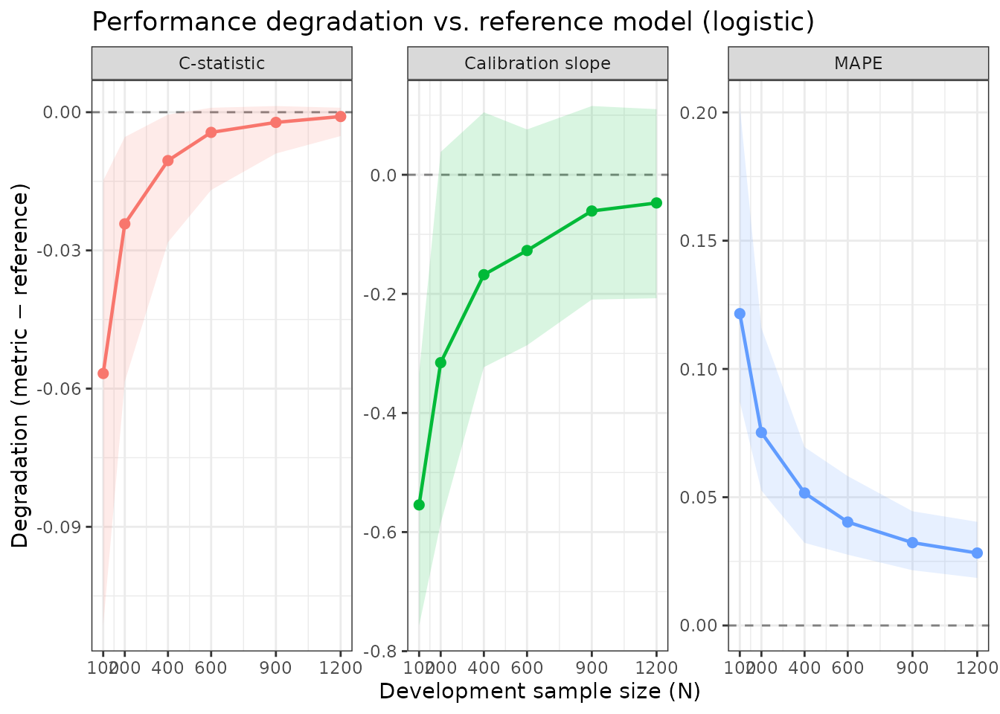
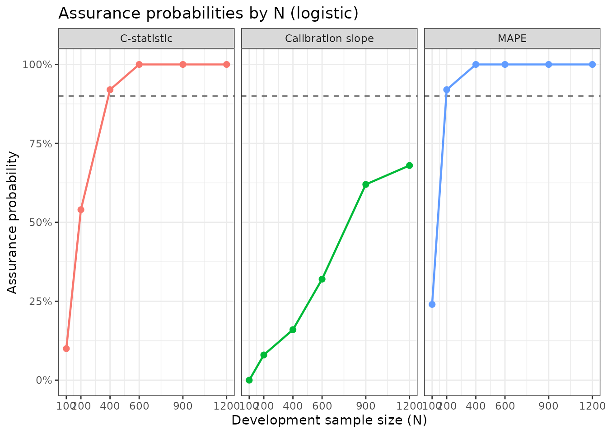

# Specifying Distributional Assumptions (No Pilot Data)

## Motivation

The standard `pmgen_*()` workflow uses a pilot dataset to characterise
the joint predictor distribution (see
[`vignette("pmgen", package = "pmsampsize")`](https://joieensor.github.io/pmsampsize/articles/pmgen.md)).
But pilot data is not always available: a researcher may only know their
anticipated target prevalence and the expected c-statistic of a
well-developed model, along with approximate marginal predictor
frequencies from the literature or clinical knowledge.

This vignette shows how to run a full sample size assessment using
**only distributional assumptions** — no individual-level data required.

The price of this convenience is the **independence assumption**:
predictors are sampled independently from their marginal distributions.
When predictors are correlated in reality, the required sample size may
shift. The direction and magnitude of this shift depends on the
correlation structure; previous work suggests the independence
assumption can be a reasonable approximation when focusing on measures
of model degradation such as expected calibration slope and MAPE (Riley
et al.). Users should treat any difference from a data-based calculation
as a source of uncertainty and, if possible, perform a sensitivity
analysis by varying the assumed marginal probabilities.

## DVT example: specifying predictors as Bernoulli distributions

To make results directly comparable to
[`vignette("pmgen", package = "pmsampsize")`](https://joieensor.github.io/pmsampsize/articles/pmgen.md),
we specify the 11 DVT predictors using their empirical marginal
prevalences from `dvt_data` — exactly as if we had read these from a
published study rather than from our own data.

The prevalences below were derived from
`colMeans(dvt_data[predictors])`:

| Predictor       | Prevalence |
|-----------------|------------|
| male            | 0.364      |
| OCuse           | 0.068      |
| malignancy      | 0.090      |
| surgery         | 0.128      |
| ab_leg_trauma   | 0.842      |
| vein_distension | 0.189      |
| calf_diff       | 0.348      |
| ab_ddimer       | 0.617      |
| pregnancy       | 0.148      |
| immobile        | 0.263      |
| clotting        | 0.168      |

``` r

library(pmsampsize)
```

## Step 1: Specify the reference model from distributional assumptions

When `joint_data` is a **named list**, each element specifies the
marginal distribution of one predictor. For binary predictors use
`list(dist = "bernoulli", prob = p)`.

We pass `n_synth = 500000` so the large synthetic population used for
bisection is of sufficient size for accurate calibration. This is the
key parameter that controls accuracy in the no-data pathway — larger
values give better calibration but take longer.

``` r

ref_nodta <- pmgen_reference(
  joint_data = list(
    male            = list(dist = "bernoulli", prob = 0.364),
    OCuse           = list(dist = "bernoulli", prob = 0.068),
    malignancy      = list(dist = "bernoulli", prob = 0.090),
    surgery         = list(dist = "bernoulli", prob = 0.128),
    ab_leg_trauma   = list(dist = "bernoulli", prob = 0.842),
    vein_distension = list(dist = "bernoulli", prob = 0.189),
    calf_diff       = list(dist = "bernoulli", prob = 0.348),
    ab_ddimer       = list(dist = "bernoulli", prob = 0.617),
    pregnancy       = list(dist = "bernoulli", prob = 0.148),
    immobile        = list(dist = "bernoulli", prob = 0.263),
    clotting        = list(dist = "bernoulli", prob = 0.168)
  ),
  prevalence = 0.21,
  cstatistic = 0.78,
  tolerance  = 0.005,
  n_synth    = 500000,
  seed       = 42
)
#> Running bisection to calibrate reference model...
#> Bisection converged: prevalence=0.2101 (target=0.2100), c-stat=0.7819 (target=0.7800)
#> Unit information matrix computed and cached.

ref_nodta
#> pmgen reference model
#> ---------------------
#>   Predictors        : male, OCuse, malignancy, surgery, ab_leg_trauma, vein_distension, calf_diff, ab_ddimer, pregnancy, immobile, clotting
#>   Intercept         : -4.7058
#>   Prevalence (achieved): 0.2101
#>   C-statistic (achieved): 0.7819
#>   Coefficients      :
#>            male           OCuse      malignancy         surgery   ab_leg_trauma 
#>          0.9375          0.9375          0.9375          0.9375          0.9375 
#> vein_distension       calf_diff       ab_ddimer       pregnancy        immobile 
#>          0.9375          0.9375          0.9375          0.9375          0.9375 
#>        clotting 
#>          0.9375 
#>   Unit info matrix  : cached (12x12)
```

## Step 2: Generate target population and run simulation

The rest of the workflow is identical to the data-based pathway.

``` r

target_pop_nodta <- pmgen_target_population(
  ref_model = ref_nodta,
  n         = 50000,
  seed       = 42
)
```

``` r

result_nodta <- pmgen_simulate(
  ref_model  = ref_nodta,
  target_pop = target_pop_nodta,
  N          = c(100, 200, 400, 600, 900, 1200),
  n_sims     = n_sims_vignette,
  method     = "logistic",
  metrics    = c("cstat", "cal_slope", "mape"),
  seed       = 42,
  verbose    = FALSE
)

result_nodta
#> pmgen result
#> ------------
#>   Method              : logistic
#>   N values            : 100, 200, 400, 600, 900, 1200
#>   Metrics             : cstat, cal_slope, mape
#>   Draws/N             : 50
#>   Predictions stored  : no
#>   Perfect prediction  : fits with predictors dropped
#>     N = 100: 17/50 (OCuse 9, malignancy 1, surgery 1, ab_leg_trauma 10, ab_ddimer 1, clotting 2)
#>     N = 200: 3/50 (OCuse 1, ab_leg_trauma 2)
#> 
#> Summary (means across simulations):
#>     N    metric       mean          sd       q025       q975 degradation_mean
#>   100     cstat 0.72467483 0.027245254 0.66997076 0.76654929    -0.0567170601
#>   100 cal_slope 0.44385141 0.124238148 0.24137163 0.66464621    -0.5543869145
#>   100      mape 0.12156377 0.029354702 0.08723463 0.20249232     0.1215637736
#>   200     cstat 0.75715832 0.014751775 0.72292242 0.77600208    -0.0242335796
#>   200 cal_slope 0.68274173 0.155280106 0.41304553 1.03656411    -0.3154965937
#>   200      mape 0.07523430 0.016985671 0.05261127 0.11602081     0.0752343045
#>   400     cstat 0.77089291 0.007915909 0.75316607 0.78087823    -0.0104989824
#>   400 cal_slope 0.83044399 0.104692452 0.67512191 1.10315696    -0.1677943338
#>   400      mape 0.05164463 0.010340985 0.03220489 0.06953392     0.0516446274
#>   600     cstat 0.77701312 0.004677403 0.76449581 0.78235472    -0.0043787763
#>   600 cal_slope 0.87104783 0.096603028 0.71190451 1.07436900    -0.1271904941
#>   600      mape 0.04031692 0.008276661 0.02760223 0.05822750     0.0403169205
#>   900     cstat 0.77918298 0.002875818 0.77241874 0.78273717    -0.0022089112
#>   900 cal_slope 0.93740149 0.081235343 0.78864908 1.11370193    -0.0608368365
#>   900      mape 0.03230212 0.006456394 0.02153978 0.04453309     0.0323021185
#>  1200     cstat 0.78045605 0.001495968 0.77621666 0.78236387    -0.0009358449
#>  1200 cal_slope 0.95097111 0.085584311 0.79089369 1.10844379    -0.0472672173
#>  1200      mape 0.02824754 0.006724366 0.01853920 0.04040378     0.0282475354
```

## Step 3: Minimum sample size

``` r

pmgen_min_n(
  result_nodta,
  criteria = list(
    cal_slope = list(range = c(0.9, 1.1), min_prob = 0.90),
    cstat     = list(max_abs_deg_mean = 0.025),
    mape      = list(max_mean = 0.05)
  )
)
#> pmgen minimum sample size
#> -------------------------
#>   Minimum N : none of the evaluated N values meets all criteria.
#>   Consider expanding the N grid (larger values).
#> 
#> Criterion compliance by N:
#>     N cal_slope cstat mape all_met
#>   100       no    no   no      no 
#>   200       no    YES  no      no 
#>   400       no    YES  no      no 
#>   600       no    YES  YES     no 
#>   900       no    YES  YES     no 
#>  1200       no    YES  YES     no
```

## Comparison with the data-based result

We now run the same assessment with the full `dvt_data` dataset (as in
[`vignette("pmgen", package = "pmsampsize")`](https://joieensor.github.io/pmsampsize/articles/pmgen.md))
and compare minimum N estimates.

``` r

data(dvt_data)

predictors <- c("male", "OCuse", "malignancy", "surgery", "ab_leg_trauma",
                 "vein_distension", "calf_diff", "ab_ddimer",
                 "pregnancy", "immobile", "clotting")

ref_data <- pmgen_reference(
  joint_data  = dvt_data,
  predictors  = predictors,
  prevalence  = 0.21,
  cstatistic  = 0.78,
  tolerance   = 0.005,
  seed        = 42
)
#> Running bisection to calibrate reference model...
#> Bisection converged: prevalence=0.2097 (target=0.2100), c-stat=0.7808 (target=0.7800)
#> Unit information matrix computed and cached.

target_pop_data <- pmgen_target_population(ref_data, n = 5000, seed = 42)

result_data <- pmgen_simulate(
  ref_model  = ref_data,
  target_pop = target_pop_data,
  N          = c(100, 200, 400, 600, 900, 1200),
  n_sims     = n_sims_vignette,
  method     = "logistic",
  metrics    = c("cstat", "cal_slope", "mape"),
  seed       = 42,
  verbose    = FALSE
)
```

``` r

cat("=== Data-based approach ===\n")
#> === Data-based approach ===
pmgen_min_n(
  result_data,
  criteria = list(
    cal_slope = list(range = c(0.9, 1.1), min_prob = 0.90),
    cstat     = list(max_abs_deg_mean = 0.025),
    mape      = list(max_mean = 0.05)
  )
)
#> pmgen minimum sample size
#> -------------------------
#>   Minimum N : none of the evaluated N values meets all criteria.
#>   Consider expanding the N grid (larger values).
#> 
#> Criterion compliance by N:
#>     N cal_slope cstat mape all_met
#>   100       no    no   no      no 
#>   200       no    no   no      no 
#>   400       no    YES  no      no 
#>   600       no    YES  YES     no 
#>   900       no    YES  YES     no 
#>  1200       no    YES  YES     no

cat("\n=== Distributional assumptions (independent marginals) ===\n")
#> 
#> === Distributional assumptions (independent marginals) ===
pmgen_min_n(
  result_nodta,
  criteria = list(
    cal_slope = list(range = c(0.9, 1.1), min_prob = 0.90),
    cstat     = list(max_abs_deg_mean = 0.025),
    mape      = list(max_mean = 0.05)
  )
)
#> pmgen minimum sample size
#> -------------------------
#>   Minimum N : none of the evaluated N values meets all criteria.
#>   Consider expanding the N grid (larger values).
#> 
#> Criterion compliance by N:
#>     N cal_slope cstat mape all_met
#>   100       no    no   no      no 
#>   200       no    YES  no      no 
#>   400       no    YES  no      no 
#>   600       no    YES  YES     no 
#>   900       no    YES  YES     no 
#>  1200       no    YES  YES     no
```

Small differences between the two approaches arise from the independence
assumption: in `dvt_data` some predictors are correlated (e.g.,
`ab_ddimer` tends to be elevated in patients with malignancy). The
independence assumption removes these correlations from the synthetic
population, which can slightly alter the effective dimensionality of the
predictor space and hence the required N.

## Visualisation

``` r

plot(result_nodta, type = "degradation")
```



``` r

plot(result_nodta, type = "assurance")
```



## Recommendations

- **Prefer the data-based approach** when any pilot data are available,
  even a small convenience sample. Even moderate correlations can shift
  required N by 10–20%.
- **Use distributional assumptions** when no data are available. Set
  marginal probabilities from published prevalence estimates or clinical
  knowledge.
- **Acknowledge uncertainty.** The independence assumption is a
  modelling choice. When reporting results, note that the true required
  N may be higher or lower depending on predictor correlations.
- **Sensitivity analysis.** Consider re-running with marginal
  probabilities varied by ±0.05 to quantify how sensitive the required N
  is to uncertainty in the assumed prevalences.

## Session info

``` r

sessionInfo()
#> R version 4.6.2 (2026-10-29)
#> Platform: x86_64-pc-linux-gnu
#> Running under: Ubuntu 26.04.1 LTS
#> 
#> Matrix products: default
#> BLAS:   /usr/lib/x86_64-linux-gnu/openblas-pthread/libblas.so.3 
#> LAPACK: /usr/lib/x86_64-linux-gnu/openblas-pthread/libopenblasp-r0.3.32.so;  LAPACK version 3.12.0
#> 
#> locale:
#>  [1] LC_CTYPE=C.UTF-8       LC_NUMERIC=C           LC_TIME=C.UTF-8       
#>  [4] LC_COLLATE=C.UTF-8     LC_MONETARY=C.UTF-8    LC_MESSAGES=C.UTF-8   
#>  [7] LC_PAPER=C.UTF-8       LC_NAME=C              LC_ADDRESS=C          
#> [10] LC_TELEPHONE=C         LC_MEASUREMENT=C.UTF-8 LC_IDENTIFICATION=C   
#> 
#> time zone: UTC
#> tzcode source: system (glibc)
#> 
#> attached base packages:
#> [1] stats     graphics  grDevices utils     datasets  methods   base     
#> 
#> other attached packages:
#> [1] purrr_1.2.2      future_1.82.0    pmsampsize_2.0.0
#> 
#> loaded via a namespace (and not attached):
#>  [1] gtable_0.3.6       jsonlite_2.0.0     dplyr_1.2.1        compiler_4.6.2    
#>  [5] tidyselect_1.2.1   parallel_4.6.2     jquerylib_0.1.4    globals_0.20.0    
#>  [9] systemfonts_1.3.2  scales_1.4.0       textshaping_1.0.5  yaml_2.3.12       
#> [13] fastmap_1.2.0      ggplot2_4.0.3      R6_2.6.1           labeling_0.4.3    
#> [17] generics_0.1.4     knitr_1.52         tibble_3.3.1       desc_1.4.3        
#> [21] pillar_1.11.1      bslib_0.12.0       RColorBrewer_1.1-3 rlang_1.3.0       
#> [25] cachem_1.1.0       xfun_0.62          fs_2.1.0           sass_0.4.10       
#> [29] S7_0.2.2           otel_0.3.0         cli_3.6.6          withr_3.0.3       
#> [33] pkgdown_2.2.1      magrittr_2.0.5     digest_0.6.39      grid_4.6.2        
#> [37] lifecycle_1.0.5    vctrs_0.7.3        evaluate_1.0.5     glue_1.8.1        
#> [41] farver_2.1.2       listenv_1.1.0      furrr_0.4.0        codetools_0.2-20  
#> [45] ragg_1.5.2         parallelly_1.50.0  rmarkdown_2.32     pkgconfig_2.0.3   
#> [49] tools_4.6.2        htmltools_0.5.9
```
